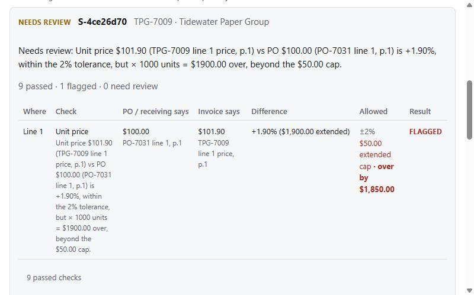
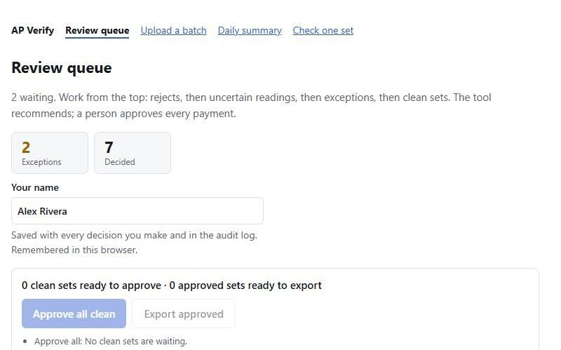

# AP Verify

**Catches the wrong payment before an accounts payable specialist approves it.**

[Live app](https://invoicematchchecker.vercel.app) (passcode-protected, synthetic data only) · Built in 7 days by Michael Goslin and Joan Albayrak

## The problem

A high-volume accounts payable (AP) specialist checks about **180 vendor invoices a day**. Before any invoice is paid, it has to match its purchase order and its receiving report: the same vendor, no more units than were ordered and received, and prices that agree. This is the three-way match, and it's done by hand, one set at a time. Prices are rarely exact, so teams allow a small difference, called a tolerance, before a person has to check. AP Verify uses **2%**, a setting we chose, not one from the job posting.

It is slow, repetitive work, and the mistakes that slip through cost real money:

- **A percentage rule hides dollars.** 1,000 units billed 1.9% over passes a 2% rule, yet that's **$1,900 overpaid**.
- **A misread number gets paid.** One digit read wrong from a scanned invoice can be approved as if it were right.
- **Duplicates get paid twice.** The same invoice resubmitted looks like new work.

## The solution

AP Verify takes the whole morning batch of POs, receiving reports and invoices. Claude reads every document; plain, tested code does the matching. Each invoice set is sorted into **Recommend approve**, **Needs review** or **Recommend reject**, with the exact values behind the decision. **The tool recommends; a person approves every payment.**



*The $1,900 case on the live app: the price is only 1.90% over, inside the 2% tolerance, but over 1,000 units that's $1,900, past the $50 cap. The set goes to a person, with the PO and invoice values side by side.*

## Key features

- **Batch upload:** drop in the morning's documents in any order. Each invoice is joined to its PO and receiving report automatically, and anything that can't be placed is set aside with a reason, never guessed.
- **Uncertainty protection:** any field Claude reads with low confidence sends the set to a person. A misread number can never be recommended for approval.
- **Traceable reasons:** every flag shows the expected and actual values, the variance and the limit it broke, so you can decide fast and defend the decision.
- **Dollar cap as well as a percentage:** a price within 2% is still flagged when it costs more than $50 on the line, so small percentages can't hide real money.
- **Original documents one click away:** open the invoice, PO or receiving report behind any set, straight from the queue.
- **Human override with an audit trail:** go against a recommendation with a reason code. Every recommendation, decision and override is written to an append-only audit log.
- **One-click approve and export:** approve every clean set at once, then export approved sets as a CSV for the ERP, each set once.

## Results

We generated 100 synthetic invoice sets with planted problems and an answer key, then ran real Claude extraction over all of them:

| Measure | Result |
| --- | --- |
| False approvals (a set approved that should have been held) | **0** |
| Confident misreads (a value read wrong with high confidence) | **0** |
| Sets whose final decision matches the answer key | **97 of 100** |

**What this doesn't prove:** the invoices are synthetic, and our one mildly degraded scan was read correctly, so real extraction never triggered the confidence gate (it's covered by tests instead). The 2% tolerance and $50 cap are settings that an AP specialist should confirm.

## User stories

1. As an AP specialist, I want to upload the morning batch all at once, so I don't match invoices to POs one at a time.
2. As an AP specialist, I want uncertain readings sent to me instead of approved, so a misread number never becomes a wrong payment.
3. As an AP specialist, I want to see exactly why a set was flagged (values, variance and tolerance), so I can decide quickly and defend the decision.
4. As an AP specialist, I want to override a recommendation with a reason, so my judgment counts and the reason is recorded.
5. As an AP specialist, I want to approve all clean sets in one click and export them, so they're ready for the ERP.

## How it works

1. **Extract (Claude):** reads each document into structured JSON with a confidence score per field.
2. **Confidence gate (code):** any low-confidence field sends the set to Needs review. A gated set can never be recommended for approval.
3. **Match (code):** fixed rules compare vendor, PO number, quantities, unit prices (within 2%) and totals, and check for duplicates.
4. **Decision trace (code):** records the values, variance, tolerance and result for every check.
5. **Explain (Claude):** restates the trace in plain English. It cannot change the outcome.

Every recommendation, human action and override is written to an audit log. Only synthetic invoices are used.



*The review queue: sets are worked from the top (rejects, then uncertain readings, then exceptions, then clean sets), every decision carries the reviewer's name, and clean sets approve in one click.*

## Tech stack

- **Next.js 16 (App Router) + TypeScript**, deployed on **Vercel**
- **Anthropic TypeScript SDK** with **Claude Opus 5.5** (`claude-opus-5-5`): structured-output extraction of every field with a confidence score and quoted evidence, plus plain-English explanations that are checked against the findings
- **Postgres** for sets, decisions, the append-only audit log and the uploaded files, through the `postgres` driver and one `POSTGRES_URL`. Production runs on **Supabase**, but any Postgres works. Tests use **PGlite**, an in-memory Postgres, so they need no database
- **Vitest** for 244 tests: every match rule, the confidence gate, the database layer and the file route, run in **GitHub Actions** on every pull request
- **Python + reportlab** (offline) to generate the 100 synthetic invoice sets and their answer key

## Project structure

| Folder | What's in it |
| --- | --- |
| `app/` | The pages (review queue, batch upload, daily summary, sign-in) and the API routes |
| `lib/match/` | The match rules, the decision trace and the set-level decision: plain code, no AI |
| `lib/extract/` | Claude extraction, the evidence check and the mapping into the rules' input |
| `lib/explain/` | Plain-English explanations, with a guard that discards any number the checks don't contain |
| `lib/db/` | Postgres access: sets, batches, decisions, the audit log and stored files |
| `lib/batch/`, `lib/queue/`, `lib/summary/`, `lib/export/` | Grouping a batch into sets, queue order and button hints, the daily summary, and the CSV export |
| `lib/eval/` | The end-to-end score against the answer key |
| `lib/documents/`, `proxy.ts` | Serving stored files safely, and the passcode gate on every page and API route |
| `db/migrations/` | The database schema, applied in order by `npm run db:migrate` |
| `sample-data/` | The Python generator, 100 synthetic invoice sets and their answer key |
| `scripts/` | Demo runs, the database migrator and the scoring scripts behind the Results table |
| `docs/` | The demo video script and the screenshots in this README |

## Team

| Builder | Role | Owns |
| --- | --- | --- |
| Michael Goslin | Builder A: engine | Extraction, confidence gate, match rules, decision trace, data model, API routes, Vercel and storage setup, merges |
| Joan Albayrak | Builder B: experience | Sample-data generator and answer key, upload and review queue UI, export and summary, demo |

## Branches and workflow

- `main`: stable, demo-ready code only.
- `dev`: integration branch. All work starts here.
- Feature branches: create one from `dev` for each piece of work, for example `feat/match-rules` or `feat/review-queue`.

1. Branch from `dev`.
2. Open a pull request back into `dev`.
3. Michael reviews and merges.
4. When `dev` is stable, Michael merges `dev` into `main`.

Nobody pushes directly to `main` or `dev`.

## Environment variables

Set these in Vercel (for both Production and Preview) and in a local `.env.local` file. Never commit them. To start, copy `.env.example` to `.env.local` and fill in your own values; git ignores `.env.local`. A changed variable only reaches a deployment after it is redeployed.

| Variable | Purpose |
| --- | --- |
| `ANTHROPIC_API_KEY` | Claude API access (server-side only). Without it, every document read fails. |
| `POSTGRES_URL` | Postgres connection string. The Supabase integration sets it on Vercel. Without it, nothing is saved and the duplicate check returns Needs review. |
| `APP_PASSCODE` | Shared passcode for the deployed app. A production deploy without it returns 503; locally, leaving it empty skips the sign-in page. |
| `POSTGRES_POOL_MAX` | Optional. Database connections per server instance (default 5). |
| `SUMMARY_TIME_ZONE` | Optional. IANA time zone that decides which day the daily summary covers (default `America/New_York`). |

Uploaded files are stored in Postgres next to what Claude read from them (migration `004_document_files.sql`), so no separate file storage is needed.

Note that `npm run dev` loads `.env.development.local`, so if that file holds the shared `POSTGRES_URL`, local uploads land in the shared queue.

## Running locally

**Prerequisites:** Node.js 22.9 or later (CI uses Node 24) and git. To upload your own documents you also need an Anthropic API key. To save sets between runs you need a Postgres database; a free Supabase project works.

1. Clone and install:

   ```bash
   git clone https://github.com/MichaelGoslin/invoicematchchecker.git
   cd invoicematchchecker
   npm install
   ```

2. Try it with no setup: run `npm run dev` and open http://localhost:3000. Without a `.env.local`, the review queue shows four built-in sample sets, there is no sign-in page, and nothing is saved.
3. To read real documents, run `cp .env.example .env.local` and fill in:
   - `ANTHROPIC_API_KEY`: required for any upload. Each set read is billed to your key, about 11 cents per set.
   - `POSTGRES_URL`: optional. The connection string from your Supabase project's **Connect** panel, or any Postgres. Without it, uploads are checked but not saved.
   - Leave `APP_PASSCODE` empty so you can skip the sign-in page locally.
4. If you set `POSTGRES_URL`, create the tables with `npm run db:migrate`. It applies each file in `db/migrations` once, so running it again is safe.
5. Restart `npm run dev`. Open **Upload a batch** (`/batch`) or **Check one set** (`/try`) and upload the sample files in `sample-data/output/sets/`. Each folder, `S-001` to `S-100`, holds one set: usually `po.pdf`, `receiving.pdf` and `invoice.pdf`. A few sets are missing a document on purpose, and S-087's invoice is a scanned `invoice.jpg`. `sample-data/output/answer_key.csv` says what each set should get; for example, S-001 should come back Needs review because 60 units were billed but only 56 arrived.
6. Run `npm test` to run the 244 tests. They need no API key or database.

Other scripts:

```bash
npm run demo:rules  # runs every rule over four sample invoice sets, then shows each decision and the queue order
npm run demo:price  # unit-price cases only
npm run score:truth   # rules engine vs the sample-data answer key (printed values, no API calls)
npm run score:extraction -- --fake   # free dry run of the end-to-end score; add --yes instead of --fake for the real run (about $11)
npm run demo:extract  # live: Claude reads the S-15 sample documents, then the rules decide (needs ANTHROPIC_API_KEY, a few cents per run)
```

## Status

App (Next.js 16): `/` is the review queue (sample sets when no database is set), and `/try` uploads one set (PO, optional receiving report, invoice) to `POST /api/match`, which reads the documents with Claude, runs the rules and returns the traces and decision. `proxy.ts` gates every page and API route behind `APP_PASSCODE`; a production deploy without it returns 503. With `POSTGRES_URL` set, every set, its recommendation and the engine snapshot are saved to Postgres, and the queue lets a named reviewer approve or reject each set. Going against the recommendation is an override and needs a written reason. Every recommendation and decision goes into an append-only `audit_log`, and every stored invoice that wasn't rejected feeds the duplicate check, including ones still pending, so a resubmission is caught before the first copy is decided. Without a database, nothing is saved and the duplicate check returns Needs review. The queue groups pending sets by why the engine placed them, shows each check side by side, and takes a reason code for overrides.

Batch (stories 1 and 5): `/batch` takes the morning batch of POs, receiving reports and invoices in any order. Each file is read on its own request (four at a time), then `POST /api/batches/:id/match` joins each invoice to the PO and receiving report that share its PO number and runs every set. Documents it can't place, such as unknown types, uncertain or shared PO numbers, or a PO no invoice cites, are set aside with a reason, never guessed. An invoice that clearly cites a PO that isn't on file is incomplete, not rejected; an uncertain PO reference gates the set. On the queue, "Approve all clean" approves only sets the engine recommended with no uncertain reads, and "Export approved" downloads a CSV for the ERP. Each set is exported once and logged, and cells are protected against spreadsheet formula injection.

Extraction: `extractDocument` in `lib/extract` reads a PDF, image or text document with Claude (`claude-opus-5-5`, structured output) into fields that each carry a value, confidence, quoted evidence and page. Code then checks each value against its quoted text and lowers confidence when they disagree; it never raises it. `toMatchInput` maps a PO, an optional receiving report and an invoice into the engine's input, and `runSet` runs every rule and decides. Tests use a fake client and make no API calls.

Engine: all match rules return a decision trace and share the confidence fail-safe (tested): PO on file (none recommends reject), receiving report on file (none makes a 3-way match incomplete; 2-way only when chosen), vendor, PO number, duplicate, quantity vs ordered and received, unit price (2% and a $50 extended-cost cap), line total and invoice total. `decideSet` turns a set's traces into Recommend approve / Needs review / Recommend reject, and `compareForQueue` sorts the review queue. Tests run in GitHub Actions on every PR, including a score against the 100-set answer key in `sample-data/output` (99 of 100 agree on printed values; the scan, S-087, depends on extraction). The UI contract is `TraceEntry` and `SetDecision` in `lib/match`; sample sets with answer keys are in `lib/match/fixtures.ts`. Explanations (step 5): on any set with findings, "Explain in plain English" asks Claude to restate the decision and its findings in two to four sentences. Claude sees only the decision and the findings, is told to treat document text as data, and can't change the outcome. If its text cites any number the findings don't contain, it is discarded and the rules' own summary is shown instead. Each set is explained once and the result is stored. The full requirements are in the team PRD.

Documents: each upload is stored with what was read from it, and the queue links to the invoice, PO and receiving report behind a set. `GET /api/documents/:id` checks the passcode itself before any lookup, looks up only ids shaped like the ones the app makes, serves exactly the stored type with `X-Content-Type-Options: nosniff` and `Cache-Control: private, no-store`, encodes the file name, and sandboxes text files. `proxy.ts` lets only `/login` itself through signed out. A path that merely starts with "login" is gated.
